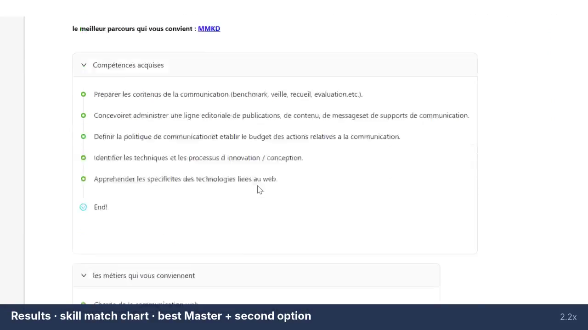

# 🎓 Academic Path Recommender — ESPRIT School of Business

A web application that recommends the **best-fit study program** for a student, based on their current diploma, their grades, their skills and the **career they dream of**.

Built for ESPRIT School of Business (Tunisia) as part of my studies.


▶️ **Full demo video (2.5 min):** [academic-path-recommender-demo.mp4](academic-path-recommender-demo.mp4)

---

## ✨ What it does

| Step | Feature |
|------|---------|
| 1 | **Sign up / log in** with email, login and password (show/hide password toggle) |
| 2 | **Choose your diploma level** — Baccalaureate or Licence |
| 3 | **Guided onboarding tour** explaining each field ("Comment ça marche ?") |
| 4 | **Enter your profile** — degree & specialty, subjects with grades, certificate upload, technical skills |
| 5 | **Pick your dream job** from a searchable list of official job codes (ROME classification) and see the specific skills it requires |
| 6 | **Get a recommendation** — a skills-match bar chart, the best program for you, a second option, the skills you'll acquire and the jobs it leads to |
| 7 | **Jump to the program page** on the official ESPRIT website in one click |

## 🧭 Two scenarios shown in the demo

**Scenario 1 — Licence graduate → Master**
A Licence in Management (Marketing specialty) student enters her grades in e-commerce, marketing and finance, picks *Marketing Consultant* as her dream job, and is recommended the **Professional Master in Digital Marketing (MKD)**, with the **LBC** program as a second option.

**Scenario 2 — Baccalaureate holder → Licence**
A Computer Science Baccalaureate holder picks an IT dream job and selects technical skills (Linux, macOS, …), and is recommended the **Bachelor Degree in Management (LSG)**.

## 🖼️ Screenshot



## 🛠️ Tech stack

> _Fill in with your actual stack, e.g.:_
- **Frontend:** …
- **Backend / API:** …
- **Recommendation model:** …
- **Database:** …

## 🚀 Run locally

```bash
# Fill in with your setup steps, e.g.
git clone https://github.com/<your-username>/<repo-name>.git
cd <repo-name>
# install & start…
```

## 👩‍💻 Author

**Karawene Ben Cheikh** — Master's in Business Analytics, ESPRIT School of Business
